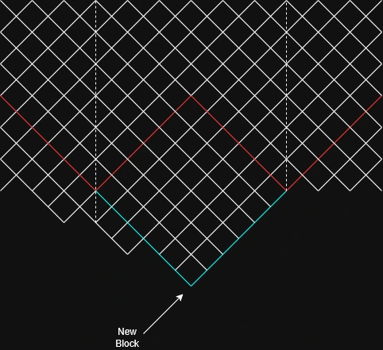
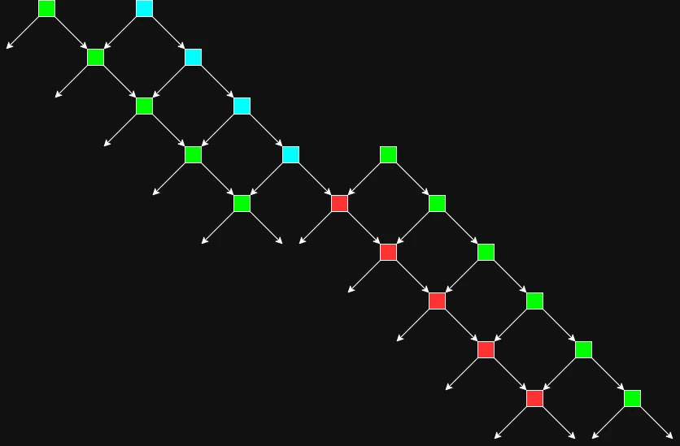
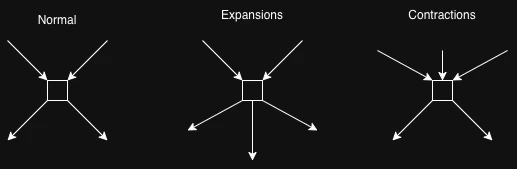

# Weave

## Graph

Consider a DAG of blocks, constrained as a lattice of quadrilaterals, with two parents giving rise to a single child. Each block is mined and competes with other forks of the graph at various boundaries. It extends temporally downward. It is laterally cyclic, one can visualise it as a cylinder of quad faces. Each block has a [MimbleWimble-like certificate](./mwac.v2.md) that it edits and hands down, one strand from each parent ([proofs](./proofs.md)). Every certificate of every block percolates down its progeny, which is the only state meant to be globally known.

## Strands

A Strand is a set of graph edges flowing in one direction (left or right). Since it's cyclic, these edges recur in a pattern every circumferential loop. A partial node holds two opposing strands from a single parent block, which is either genesis or epochal. When one of the strands meets the meridian, the other eclipses it at the antipode, crossing into it. Thus, we have a diamond-shaped set of edges that enclose a bunch of blocks (called the Saros) not necessarily known by the partial node. We do, however, know that they're effectively enclosed by the upper and lower halves of our chosen strands (the blocks we have) and that, since they reach the meridian on both sides, the children (the lower halves of both strands, in cyan) are *all* the children of the graph before them.

Forks occur over heaviest left-strand, ensuring multiple parallel linear competitions for consensus.

A partial node authors a block using UTxOs from only those two strands it has. It allows wallets to "reroute" their outputs from one strand to another, acting as a conduit to allow coins from any part of the graph to move anywhere else. It can take any epoch block's (one part of an epoch ring) vertical progeny (the one directly below, longitudinally/temporally) and be part of that "shard", being able to produce blocks amongst a council of validators that share its Saros.
### Sharding

Shards are committees nodes that share the same Saros, having the same two strands as state. There exist $\text{Circumference}^2$ at a given hash power, measuring circumference $P$ in blocks per ring.

*Why:* every block sits where one left strand crosses one right strand, so a ring of $P$ blocks is crossed by $P$ left and $P$ right strands. A left and a right strand close in on each other by one block per layer, so they meet exactly once every $P$ layers. Over any $P$ consecutive layers there are $P \times P$ blocks and each pair of strands meets exactly once, so all $P^2$ pairs (shards) exist and each authors one block per $P$ layers. An expansion or contraction adds or removes one strand pair, moving the count to $(P \pm 1)^2$.
## Percolation

Certificates percolate from the red to the cyan. If the blocks inside have invariant supply and are exclusive, it's guaranteed that the ledger is valid, regardless of what happens in shards outside the partial node's scope.
If it doesn't, we have a liveness failure and are prevented from doing work until a competing valid subgraph emerges and overtakes, at which point we know that the bad actors have been taken care of in the problematic shard.

## Elasticity

Extending this model to be a bit more flexible, we assume the graph to be locally elastic, allowing certain parts to stretch to change global circumference, thus increasing shard count.
As hash power accumulates with adoption, instead of increasing difficulty targets, one can expand the blockspace inflow pipeline.
Saros boundaries keep their meaning because deformations only ever add or remove a whole strand pair: an expansion's middle child opens a new, empty pair, and a contraction's top parent ends one, whose coins are adopted by the child below. Defects may not touch one another, so every merge still has a single shared parent to check. Full rules are in [the certificate scheme](./mwac.v2.md#elasticity).

Elasticity tries to have the prover do the same amount of work as the blockchain scales up, by demanding more honest provers come into the supply, decreasing the burden of a single prover. Expansions happen when local nodes detect new block timestamps drifting further apart, vice versa for contractions. As circumference increases, the strands grow larger, also causing the prover to have more downtime between mining sessions than before, since it can only mine blocks during strand intersections in its shard. The increase in strand length will increase Saros area, which would optimally be constant time in prover capability due to modern folding schemes.